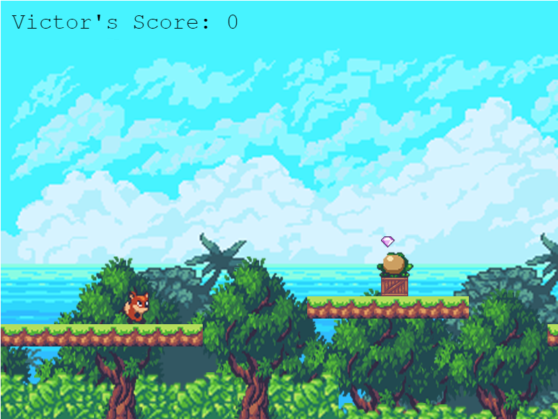

# Sunny Land (Platform game capstone project)

> It's a 2d game with a cute fox who set himself out for an endless adventure to jump collect gems and avoid frogs on speeding various platforms



## Built With

- [Phaser 4](https://phaser.io/) (arcade physics, WebGL with `smoothPixelArt`)
- JavaScript (ES2022 modules)
- webpack 5 + webpack-dev-server
- Bootstrap 5 (name modal)
- Jest 30, ESLint 10, Stylelint 17

## Live Demo

[Live Demo Link](https://vichuge.github.io/js-capstone-endless-runner/)

## Game Design Documment

This is a game based on an endless running journey and the hero is a cute fox with a mission to collect as many gems as possible to come as number 1 on the leaderboard.
He must avoid frogs and falling or otherwise he meets his doom.
The cute fox can jump once, and twice in midst of air defying rules of physics and allowing him to avoid falling to infinity or falling.
[Game Design Document (GDD) Link](./GDD.md)

### How to play

- **Start a run:** click *Play* or press `Space` on the title screen
- **Jump / double jump:** left click, tap, `Space` or `↑` (press again in the air to double jump)
- **Play again:** click *Play again* or press `Space` on the Game Over screen
- Short control hints appear on the title, in game and on Game Over (touch devices see "Tap" hints).
- Collect gems (+10), avoid frogs, don't fall.
- Scores are saved in your browser (see *Leaderboard* below).

### Prerequisites

- Node.js 20.19+ (22 recommended, see `.nvmrc`)

### Setup

```bash
git clone https://github.com/vichuge/js-capstone-endless-runner.git
cd js-capstone-endless-runner
npm install
npm start
```

Then open <http://localhost:8080>. The dev server rebuilds and reloads on every change.

### Scripts

| Command | What it does |
| --- | --- |
| `npm start` | Dev server at <http://localhost:8080> (in-memory bundle, live reload) |
| `npm run build` | Production bundle into `dist/main.js` (what GitHub Pages serves) |
| `npm run dev` / `npm run watch` | Development bundle written to `dist/` (once / on every change) |
| `npm test` | Jest unit tests |
| `npm run lint` / `npm run lint:fix` | ESLint + Stylelint (and autofix) |

### Leaderboard

The original Microverse leaderboard API this project used has been shut down, so
scores are now stored in the browser's `localStorage` (top scores per browser).
To use a remote leaderboard again, set `SCORES_API_URL` in `src/scores.js` to an
API that answers `GET → { result: [{ user, score }] }` and accepts `POST { user, score }`.

### Testing

```bash
npm test
```

## Author

👤 **Victor Pacheco**

- GitHub: [@vichuge](https://github.com/vichuge)
- LinkedIn: [LinkedIn](https://www.linkedin.com/in/victor-pacheco-7946aab2/)

## Show your support

Give a ⭐️ if you like this project!

## Acknowledgments

- Artwork created by Luis Zuno [@ansimuz](https://www.patreon.com/ansimuz)
- Music by Pascal Belisle
- UI pack by [Kenney Vleugels](https://www.kenney.nl/)
- sound effects by [opengameart.org](https://opengameart.org/)
